<p align="center">
  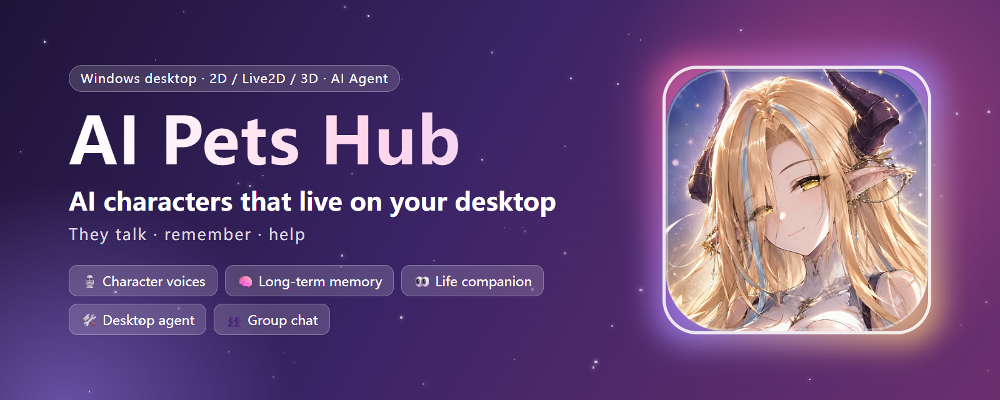
</p>

<h1 align="center">AI Pets Hub</h1>

<p align="center">
  <a href="./README.zh-CN.md">简体中文</a> | <strong>English</strong>
</p>

<p align="center">
  
  
  
  <a href="https://github.com/JingXuan-Zun/AI-Pets-Hub-public/releases/latest"></a>
  <a href="./LICENSE"></a>
</p>

<p align="center">
  <a href="https://github.com/JingXuan-Zun/AI-Pets-Hub-public/releases/latest"><strong>⬇️ Download for Windows</strong></a> ・
  <a href="#quick-start">🚀 Quick start</a> ・
  <a href="#features">✨ Features</a> ・
  <a href="#contact">💌 Community</a>
</p>

**AI Pets Hub is an AI companion platform for the Windows desktop: your characters live on your screen, talk to you, remember you, and — when you allow it — help you operate your computer.**

> Built with Electron, React, and TypeScript. Put 2D image / video, Live2D, or VRM / MMD / 3D characters on your desktop;
> give each one its own personality, voice, wake words, and memories, then chat one-on-one, in a group, or play out a story.
> Memories are proposed by the character and saved only after you approve them, and screen watching starts only with your consent.
> Chatting and getting things done share one conversation loop: say it, and she does it — asking you out loud before any step that changes something.

---

## ✨ At a Glance

- 🐾 **Desktop companions** — Characters stay on your desktop: drag them around, watch them idle, move, and change expressions; run several at once
- 🎭 **Characters you design** — Each character has its own name, personality, system prompt, knowledge base, look, and voice
- 💬 **Solo · group · story chat** — Talk with one character, let several chat together, or act out a story; you can even hand a task to another character by name
- 🛠️ **Say it, she does it** — Opens apps, clicks buttons, types, tidies your desktop, moves windows; one card per task, and she asks out loud before changing anything
- 📋 **Reminders · to-dos · pomodoro** — Say it once and it's noted; she reminds you out loud when it's time
- 🗣️ **Settings by voice** — "Bigger text", "make yourself bigger", "read slower" — changes apply instantly
- 🎙️ **Characters with real voices** — GPT-SoVITS voices with swappable voice packs; say a wake word and just talk
- 🧠 **They remember you** — Characters propose what to remember and save it only after you approve; every character shares what they know "about you"
- 👀 **Life companion** — Only with your consent does a character look at what you're doing and check in on you; disconnect with one click
- 🔌 **Extensible** — MCP tool servers, ComfyUI image generation, SillyTavern presets; bring whichever model and voice services you like
- 🔐 **Privacy first** — API keys are encrypted on your machine; chats and memories stay on your own computer

---

## 🖼️ Preview

<p align="center">
  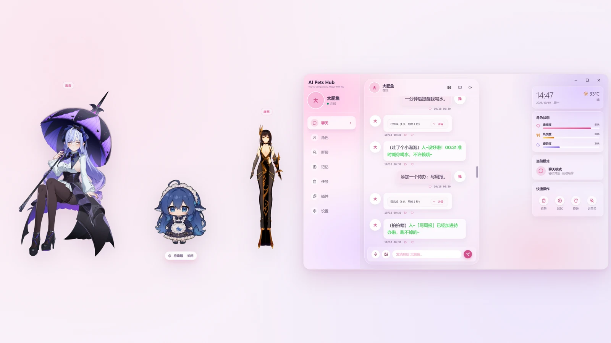
</p>

<p align="center"><sub>Screenshots use demo characters; you bring your own character models and voices. The app UI is in Chinese.</sub></p>

---

<a id="agent-loop"></a>

## ⚙️ The Agent Loop

> Chatting and getting things done share one conversation loop: the model calls tools directly, several per round if needed; desktop operations go through a purpose-built desktop agent loop.
> Source: [`src/agent/conversation/`](./src/agent/conversation/) (conversation loop and tools) · [`src/agent/loop/`](./src/agent/loop/) (desktop operations)

<p align="center">
  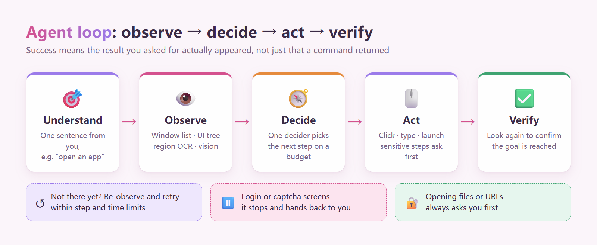
</p>

The key difference from "have the model emit a list of commands and run them" is that **after every step it looks at the screen again to confirm the result you asked for actually appeared**. A launch command returning success does not prove the right window opened; a task only counts as done once it is verified.

<details>
<summary><b>Design details</b> (click to expand)</summary>

- **One loop, one decider** — Chat and tasks run through the same loop; the model picks the next step within a step and time budget, so multiple planners never fight each other.
- **One card per task** — Every step is written on the task card, and you can press "stop" at any time.
- **Asks out loud** — Before a step that changes something, the character asks in her own voice; just say "OK" or "no", or use the buttons on the card.
- **Tiered observation** — It looks the cheap way first (window list, UI Automation tree), falls back to region OCR, and only then to a vision model; on-screen elements get numbered marks so the model can point at them precisely.
- **Task-scoped approval** — Clicks and typing can continue once you approve the task; opening files or URLs, steps that name a file path, and local project actions ask for fresh approval every time.
- **Verify after acting** — After each action it observes again to confirm the target state; if not reached, it recovers by re-locating or trying another way.
- **Knows when to stop** — On login or captcha screens that shouldn't be automated, it stops and hands control back to you.
- **Works with elevated windows** — For apps running as administrator (such as game launchers), clicks and typing go through a local helper authorized once per session, so the pet itself never needs to run as administrator.
- **Safety boundaries** — Tool output is treated as data, never as instructions; agent file tools stay away from credentials and app data; IPC is trusted only from the bundled app page.

See the [project overview](./docs/project-overview.en.md) for the full Agent Runtime.

</details>

---

<a id="quick-start"></a>

## 🚀 Quick Start

### Option 1: Download the portable build (recommended)

1. Open the [Releases page](https://github.com/JingXuan-Zun/AI-Pets-Hub-public/releases/latest) and download `AI-Desktop-Pet-<version>.exe`.
2. Double-click to run — no installer needed.
3. Fill in your model service as described in [First-run setup](#first-setup).

> [!NOTE]
> The app is not yet code-signed, so Windows SmartScreen may show a warning. Make sure the file came from this repository's Releases page before running it; you can also check it against the published SHA-256 file.

### Option 2: Run from source

**Requirements:** Windows 10 / 11 64-bit, [Node.js](https://nodejs.org/) 20 LTS or newer, npm, Git.

```powershell
git clone https://github.com/JingXuan-Zun/AI-Pets-Hub-public.git
cd AI-Pets-Hub-public
npm ci
npm run desktop
```

`npm run desktop` builds the UI and then launches the Electron desktop app. For UI-only work, use `npm run dev`.

<details>
<summary><b>Common development commands</b> (click to expand)</summary>

```powershell
npm run lint            # TypeScript type check
npm run build           # Build the UI
npm run smoke:agent:p0  # Focused agent smoke checks
npm run dist:win        # Build the Windows distribution
```

There are also check scripts for Agent, Neural Persona, MCP, Skills, and the desktop runtime; see [`package.json`](./package.json) for names and arguments.

</details>

---

<a id="first-setup"></a>

## 🔑 First-run Setup

After launch, open the **Settings center** and configure what you need:

1. **🤖 Model service** (required): pick Gemini or any OpenAI-compatible API and enter the API key, base URL, and model name. Chat and the agent both depend on it.
2. **🎭 Characters**: name your character, write its personality and system prompt, and import 2D / Live2D / 3D models and motions.
3. **🔊 Voice** (optional): choose browser speech, the OpenAI / Gemini speech APIs, or local GPT-SoVITS; pick a voice pack for each pet and set wake words.
4. **👀 Life companion / 🛠️ Agent** (optional): enable as you like — screen watching and desktop actions always ask for your consent first.

> [!TIP]
> API keys are encrypted with the operating system and stored only on your machine, never in the repository or the build. If encryption is unavailable, saving is refused rather than falling back to plain text.

---

<a id="features"></a>

## ✨ Features

### 🐾 Desktop Companions

<p align="center">
  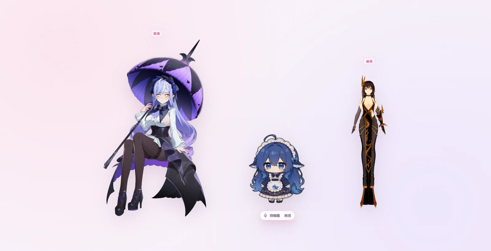
</p>

- **Many character formats** — 2D images / video, Live2D (PixiJS + Cubism), 3D models such as VRM / GLTF / GLB / FBX, **MMD (PMX / PMD) models with VMD motions**, plus a Unity runtime bridge.
- **Real physics** — MMD hair and skirts swing with the model's own rigid bodies and joints; drag a character and they sway along, then settle on their own.
- **Motion and expressions** — Idle, drag, click reactions, and emotional expressions are scheduled by one runtime; 2D video pets rotate through library folders and play clips matching the current emotion.
- **Several pets at once** — Place multiple characters on screen, each configured independently; drag them in settings to reorder.
- **Separate windows** — Pets, chat, and settings are independent windows that share one state.

### 🎨 Pink Glass Theme

<p align="center">
  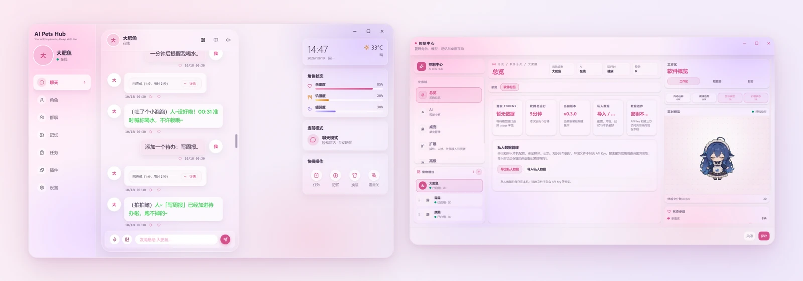
</p>

A pink glass look across the chat window and settings center; the settings center has a live preview that frames 3D models automatically.

### 💬 Character Chat

- **Three modes** — Solo chat for one-on-one company; group chat where characters talk and reply to each other; story mode for playing out a scene.
- **Hand a task over by name** — While chatting with one character, say "have XX help me…" and another character takes over, answering under her own name and in her own voice.
- **Every character speaks up** — Startup greetings, getting hungry, growing closer: each character speaks in her own manner.
- **Personality and knowledge** — Every character has its own name, personality, system prompt, knowledge base, and conversation context; SillyTavern presets can be imported and switched entry by entry.
- **Long chats without forgetting** — History stays on your machine, and very long conversations get automatic summaries.
- **Your choice of model** — Gemini or any OpenAI-compatible API, with streaming replies and image input.

<p align="center">
  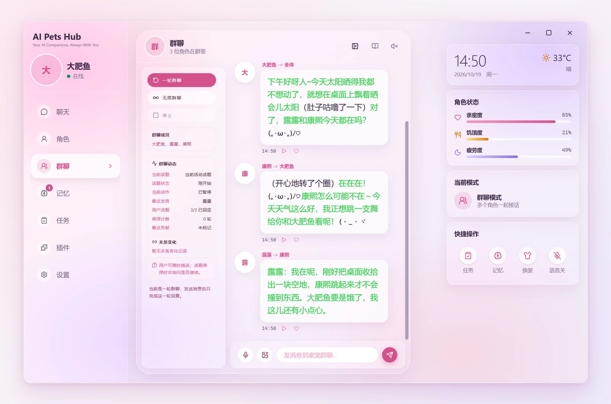
</p>

### 🧠 Memory and Persona

<p align="center">
  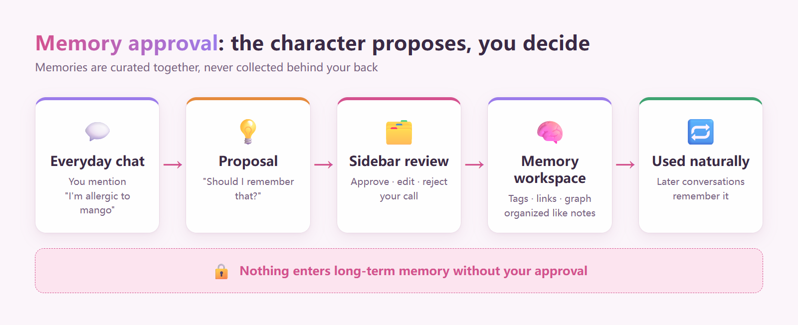
</p>

- **Memory approval** — When something worth remembering comes up, the character asks "should I remember that?"; you approve, edit, or reject it in the sidebar. **Nothing enters long-term memory without your approval.**
- **Shared "about you" memory** — Tell one character "remember this" and every character knows; "forget it" asks to confirm before deleting.
- **Memory workspace** — Obsidian-style memory notes: drag to link, add tags, and browse the relationship graph, just like organizing notes.
- **Neural Persona** — Organizes a character's long-term information into a browsable, maintainable persona graph.
- **Groups and relationships** — Group memory, directed relationships between characters, and a social timeline lay the groundwork for characters living together.

<p align="center">
  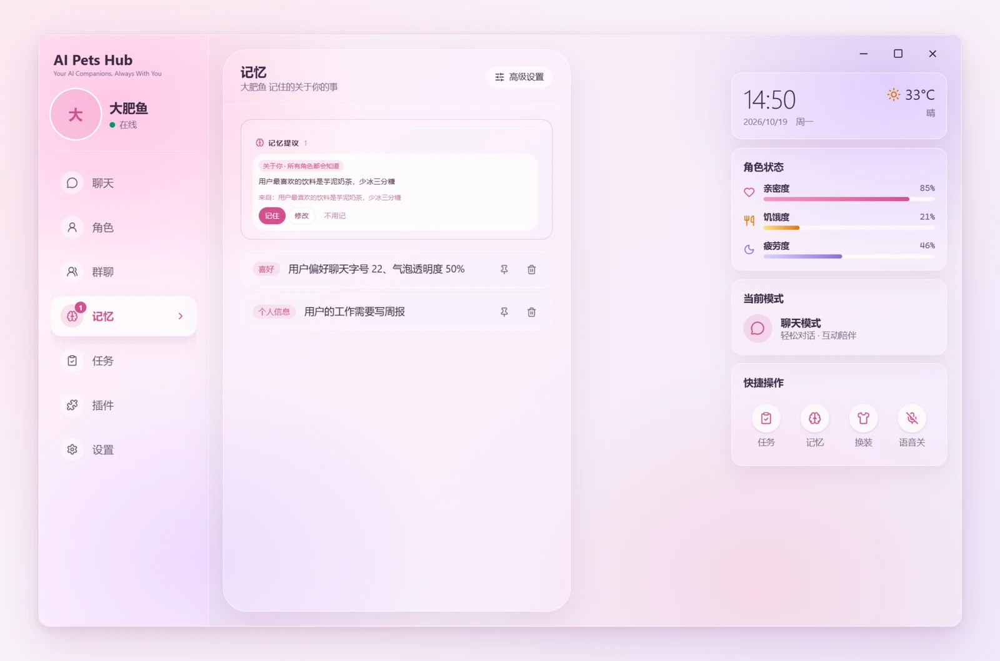
</p>

### 🔊 Voice

- **A voice for every character** — GPT-SoVITS support: lite voice packs need only a few reference recordings, trained packs sound closer to the original; each pet slot can use a different voice.
- **Many voice sources** — Browser speech, OpenAI / Gemini speech APIs, a local voice runtime, or GPT-SoVITS.
- **Hands-free conversation** — Just talk to your character; each one has its own wake words, matched by sound so misheard homophones still work.
- **Visible status** — Mic status appears under the character: "waiting for wake word" or "listening to you".
- **Smooth long replies** — Long replies are synthesized in complete sentence groups and played as they are ready.

See [`docs/voice-pack-format.md`](./docs/voice-pack-format.md) for the voice pack format.

<p align="center">
  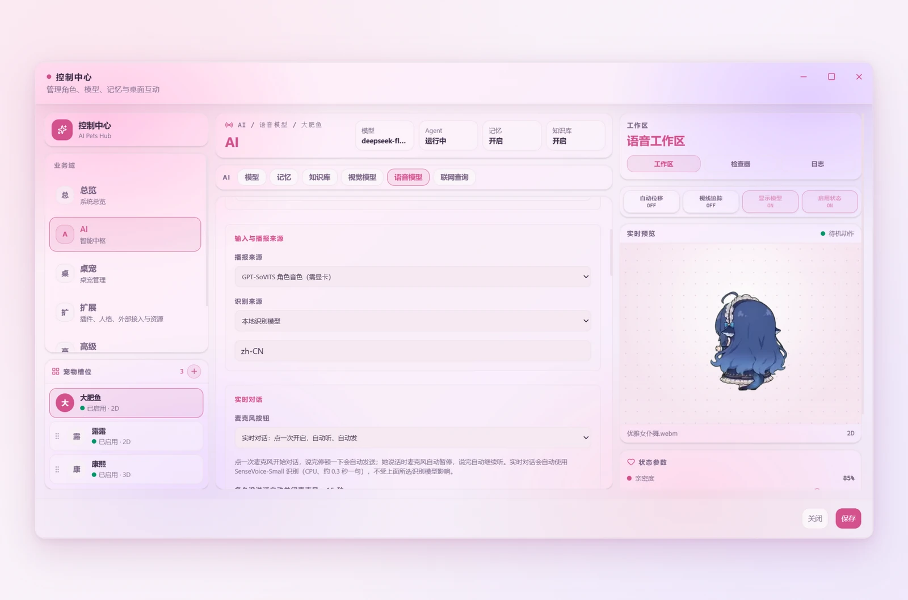
</p>

### 👀 Life Companion

- **Asks before looking** — When a character wants to know what you're doing, it asks first; screen watching starts only after you agree.
- **Disconnect anytime** — A disconnect button sits under the pet, and saying no in chat disconnects immediately.
- **Checks in on you** — Mood, affection, time of day, and quiet hours decide when it's a good moment to say something.

<p align="center">
  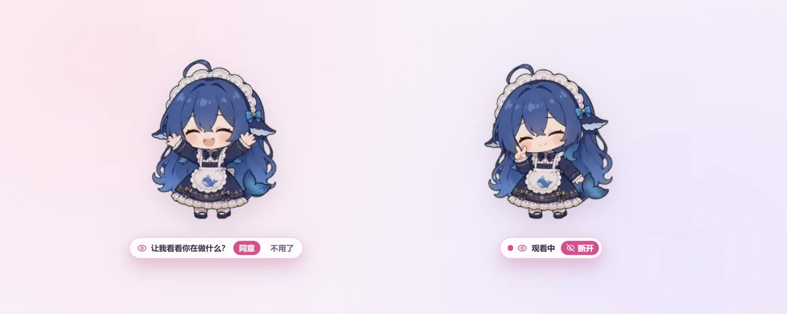
</p>

### 🛠️ Say It, She Does It

<p align="center">
  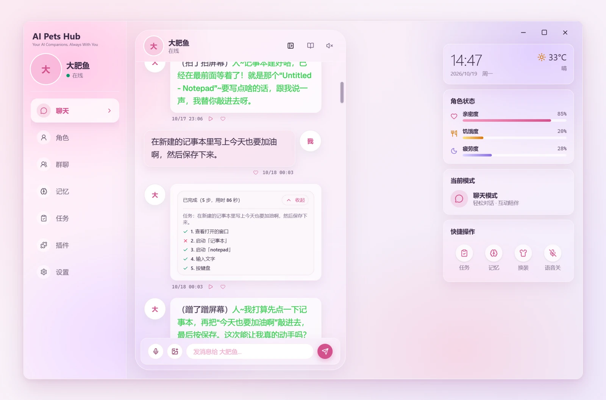
</p>

- **Characters that can act** — Open apps, click buttons, type, press keys, open web pages, search the web, check system info, and run commands; apps running as administrator work too (after a system prompt).
- **Desktop tidying** — Tidy just one screen and sort icons by file type, or move an icon to a named spot on a chosen screen ("bottom-right of the second screen").
- **Moving windows** — "Put Notepad in the bottom-right of the second screen" in one step, keeping the window size.
- **A process you can see** — One card per task shows each step as it happens; failed steps are marked, and she tries another way.
- **Permissions you control** — Read-only observation and actions that change things are handled separately; she asks before any change, and you can press "stop" at any time.

See [The Agent Loop](#agent-loop) above for how it works.

### 📋 Reminders · To-dos · Pomodoro

- **Say it once** — "Remind me about the meeting at 3 pm", "add a to-do: weekly report", "start a pomodoro"; she reminds you out loud when it's time.
- **Tasks page** — The Tasks page in the chat hub shows reminders, to-dos, and the pomodoro together, the same data the conversation uses.

### 🗣️ Settings by Voice

- **Common settings in one sentence** — "Bigger text", "more transparent bubbles", "make yourself bigger", "stop wandering around", "read slower", "don't read the bracketed actions", "hide the activity area frame" — applied instantly.
- **Characters and data** — Create a pet, give a character another model, back up and restore data, all from chat (confirmed first; restoring backs up the current state automatically).

### 🔌 Extensions and Integrations

- **MCP** — Connect external MCP tool servers: `mcpServers` configs copied straight from a README, `npx` launches, and remote servers with keys all work; tools a server declares read-only don't need a confirmation every time.
- **ComfyUI image generation (preview)** — Add your server address and import a workflow, then say "draw…" in chat; the character writes the prompt from the conversation and the image appears in the chat.
- **Skills** — Import skill instructions the character can draw on during a conversation.
- **Persona sharing** — Import or share reusable persona presets (requires a configured sharing service).
- **More runtimes** — Unity Bridge and DeepSeek Harness Bridge.

---

## 🔐 Privacy and Security

- **Your data stays local** — Chat history, memories, character settings, and configuration are stored on your computer.
- **Encrypted credentials** — Model, search, and voice API keys are encrypted with Electron `safeStorage`; requests with saved model keys are made by the main process and the keys are not sent back to the UI.
- **New address, new key** — Changing a compatible API base URL requires re-entering the key, so a saved key is never forwarded to a new address.
- **You decide** — Screen watching, opening files and URLs, and local project actions all need your consent first.

<details>
<summary><b>More security details</b> (click to expand)</summary>

- Browser dev mode never writes API keys to `localStorage`; you re-enter them after reopening.
- Legacy desktop storage copies have credential fields cleared after a successful secure save or migration.
- Some request paths for search and voice credentials have not yet moved to the main process.
- Encrypted configuration is not a cross-device key backup.
- Please report security issues through GitHub private vulnerability reporting and avoid publishing exploitable details before a fix.

</details>

---

## 📊 Project Status

The project is in early public development: the core experience works, and some capabilities are still being polished.

| Module | Status | Notes |
| --- | :---: | --- |
| Desktop companions and windows | ✅ Ready | Pets, chat, and settings run independently and share state |
| Character chat (solo / group / story) | ✅ Ready | Requires your own model service |
| Say it, she does it (conversation agent) | ✅ Ready | Opening apps, tidying the desktop, and moving windows are tested; complex multi-step UI work is still slow |
| Reminders / to-dos / pomodoro | ✅ Ready | Data stays on your machine |
| Memory approval and "about you" memory | ✅ Ready | Deeper Neural Persona integration with chat is in progress |
| Voice and wake words | ✅ Ready | GPT-SoVITS must be installed separately; a GPU is recommended |
| Life companion | 🧪 Preview | Screen watching needs your consent and can be disconnected anytime |
| 2D / Live2D / VRM / MMD characters | ⚙️ Needs assets | Runtimes are ready; bring your own models and motions |
| MCP / ComfyUI | 🧪 Preview | Third-party compatibility varies; ComfyUI has only been tested against a mock server |
| Unity Bridge / DeepSeek Harness | ⚙️ Needs setup | Require their external runtimes |

<details>
<summary><b>Known issues and focus areas</b> (click to expand)</summary>

**Known issues**

- When opening an app, a browser tab whose title contains the app's name may be switched to instead of launching the app.
- English app names spoken aloud are often misrecognized; Chinese names work better.
- 2D video characters can't yet play a specific clip by name on request.
- After switching characters in the chat sidebar, the chat window only follows once reopened.
- App windows do not yet enable the sandbox or a CSP.

**Focus areas**

- Interactive dialogue: talk with your character face to face, like a video call.
- Specialist agent plugins: package abilities such as translating, writing, or organizing files as "skill cards" the character can call on.
- Let Neural Persona, long-term memory, and character relationships play a bigger part in everyday chat.
- Let characters share recent news, so each one knows what you have talked about with the others.

</details>

---

## 🧱 Tech Stack

<p align="center">
  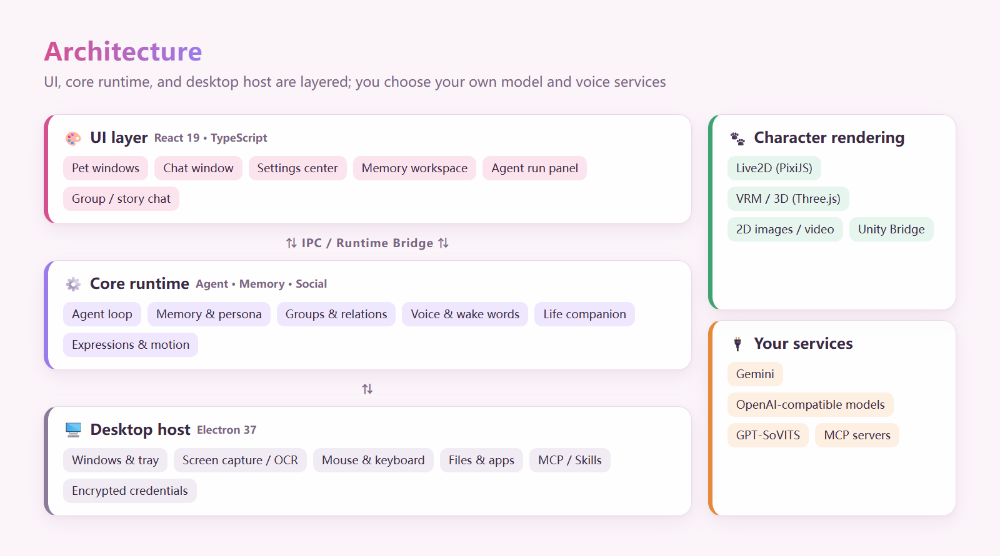
</p>

| Layer | Technology |
| --- | --- |
| Desktop host | Electron 37 · Electron Builder |
| UI | React 19 · TypeScript 5.8 · Vite 6 |
| 2D / Live2D | PixiJS 6 · `pixi-live2d-display` · Cubism Core |
| 3D | Three.js · React Three Fiber · `@pixiv/three-vrm` · MMD (PMX/VMD) with ammo.js physics |
| AI | Gemini · OpenAI-compatible APIs · in-house agent and MCP runtime |
| Voice | GPT-SoVITS · browser speech · OpenAI / Gemini speech APIs |

<details>
<summary><b>Project structure</b> (click to expand)</summary>

```text
electron/                 Electron main-process services and desktop integration
src/agent/                Agent sessions, planning, tools, execution, verification
src/agent/conversation/   The conversation loop: chat, tools, task cards, spoken approval
src/agent/loop/           Desktop operations: observe → act → verify
src/platform-capabilities/ Settings, characters, and data the character can change by voice
src/productivity/         Reminders, to-dos, and pomodoro
src/pet-runtime/          2D / Live2D / VRM / MMD character runtimes
src/neural-memory/        Memory proposals, approval, and the memory workspace
src/character-graph/      Character graph and Neural Persona
src/life-companion/       Life companion
src/voice/                Speech synthesis, recognition, and wake words
src/social-group/         Group interaction
docs/                     Project overview, voice pack format, maintenance notes
scripts/                  Checks, builds, and maintenance scripts
```

This is a map of entry points; see the [project overview](./docs/project-overview.en.md) for the full module list.

</details>

---

## ⚠️ Disclaimer

- This project ships no AI models, voice models, or character assets; you provide your own and make sure you have the rights to use them.
- When using third-party model services, follow their terms; any charges are between you and the provider.
- The desktop agent operates your computer after you approve it. Use it for tasks you trust and pay attention to each confirmation prompt.
- The project is provided as is, without liability for any loss arising from its use.

---

## 📄 License

Project source code is licensed under the [PolyForm Noncommercial License 1.0.0](./LICENSE) (source-available, noncommercial).

| Use | Allowed? |
| --- | --- |
| Personal study, research, and private use | ✅ Free |
| Modifying the source and making your own version | ✅ Free (noncommercial) |
| Noncommercial sharing and redistribution | ✅ Free, with the license and copyright notices |
| Use by schools, charities, and public research organizations | ✅ Free |
| Commercial use (selling, paid services, company business use, ad revenue, bundling into commercial products, etc.) | ❌ Requires a separate commercial license |

**Commercial licensing:** contact us in QQ group **1082932504**.

This table is a summary for convenience; the [LICENSE](./LICENSE) text governs.

- Versions released before v0.2.0 (v0.1.0) were published under Apache-2.0, and that grant is unaffected by this change.
- The character illustration in the application icons is creator-owned and **excluded from the source license**. See [ASSET_LICENSES.md](./ASSET_LICENSES.md).
- Third-party dependencies and user-provided character models, animation, audio, and other assets remain subject to their own licenses; see [PUBLIC_EXPORT.md](./PUBLIC_EXPORT.md) for the scope of this public repository.

---

## 🤝 Contributing

Issues and pull requests are welcome! For larger changes, please open an issue to discuss first. When reporting a problem, please include:

- Your Windows version and the app version / commit
- Steps to reproduce, expected result, and actual result
- Relevant logs or screenshots (**remove API keys, tokens, personal paths, and chat content first**)
- For agent issues, the task description and the steps shown in the run panel

Please read the [privacy checklist](./docs/PUBLIC_PRIVACY_WORKFLOW.md) before contributing.

---

<a id="contact"></a>

## 💌 Community and Support

- 💬 **QQ group: 1082932504** (questions, feedback, and commercial licensing)
- 🐛 **Bug reports:** [GitHub Issues](https://github.com/JingXuan-Zun/AI-Pets-Hub-public/issues)

If this project makes your desktop a little warmer, a ⭐ Star means a lot to us!
