<p align="center">
  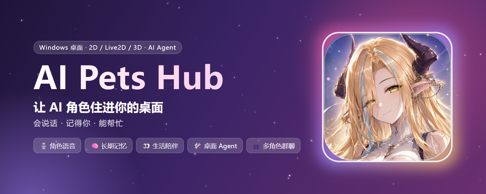
</p>

<h1 align="center">AI Pets Hub</h1>

<p align="center">
  <strong>简体中文</strong> | <a href="./README.md">English</a>
</p>

<p align="center">
  
  
  
  <a href="https://github.com/JingXuan-Zun/AI-Pets-Hub-public/releases/latest"></a>
  <a href="./LICENSE"></a>
</p>

<p align="center">
  <a href="https://github.com/JingXuan-Zun/AI-Pets-Hub-public/releases/latest"><strong>⬇️ 下载 Windows 便携版</strong></a> ・
  <a href="#quick-start">🚀 快速开始</a> ・
  <a href="#features">✨ 功能</a> ・
  <a href="#faq">❓ 常见问题</a> ・
  <a href="#contact">💌 加入交流群</a>
</p>

**AI Pets Hub 是一个运行在 Windows 桌面上的 AI 角色伴侣平台：让你的角色常驻桌面，会说话、记得你，还能在你允许时帮你操作电脑。**

> 基于 Electron + React + TypeScript 开发。2D 图片 / 视频、Live2D、VRM / MMD / 3D 角色都能放上桌面；
> 每个角色有自己的人格、声音、唤醒词和记忆，可以单聊、群聊或演一段剧情；
> 记忆由角色提议、经你批准才写入，屏幕观察也只在你同意后才开始；
> 聊天和办事是同一个对话循环：说一句，她就去做，会改动东西的步骤先开口问你。

---

## ✨ 速览

- 🐾 **桌面陪伴** — 角色常驻桌面，可拖拽、待机、做动作、换表情；可以同时摆放多个桌宠
- 🎭 **你的角色，你来定** — 每个角色独立设置名字、人格、系统提示词、知识库、外观和声音
- 💬 **单聊 · 群聊 · 剧情** — 和一个角色聊天，或让多个角色一起聊、一起演；还能点名让另一个角色去干活
- 🛠️ **说一句，她就去做** — 打开软件、点按钮、输入文字、整理桌面、挪窗口；每个任务一张卡片，会改动东西的步骤先开口问你
- 📋 **提醒 · 待办 · 番茄钟** — 说一句就记下，时间到了她亲口提醒你
- 🗣️ **说话就能改设置** — “字大一点”“你变大一点”“读慢一点”，说完立即生效
- 🎙️ **会说话的角色** — GPT-SoVITS 角色语音，可换语音包；喊唤醒词就能直接对话
- 🧠 **记得你的事** — 角色提议要记住什么，你批准后才写入；所有角色共享“关于你”的记忆
- 👀 **生活陪伴** — 经你同意后才看你在做什么，主动关心你；打游戏时还能陪你聊两句；随时一键断开
- 📞 **互动对话** — 像视频通话一样，角色出现在聊天窗口里和你面对面聊天（预览）
- 📱 **手机上也能聊** — 连上 QQ 或微信，在手机上和她聊天、发图、收她的语音；她画的图、要你点头的事也会发到手机上
- 🧩 **插件市场** — 在线插件市场一键安装；把插件的 GitHub 链接发给她，她看懂、说清楚、问过你再装；没有合适的还能和她一起做一个
- 🌐 **她自己的浏览器** — 她用自己的浏览器和账号上网、点按钮、填表、截图，和你的浏览器、账号完全分开
- 🔌 **可扩展** — MCP 工具服务器、ComfyUI 画图、SillyTavern 预设；模型可以存好几套、一键切换
- 🔄 **软件里就能更新** — 新版本只下载改了的部分，重启生效；觉得新版本不好用，还能换回旧版本
- 🔐 **隐私优先** — API Key 本机加密保存，聊天和记忆都留在你自己的电脑上

---

## 🖼️ 预览

<p align="center">
  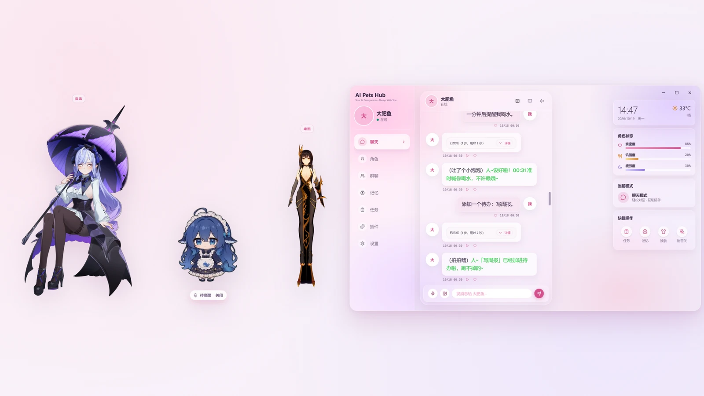
</p>

<p align="center"><sub>截图使用的是演示角色；角色模型和语音素材需要你自己准备。</sub></p>

---

<a id="agent-loop"></a>

## ⚙️ Agent 执行循环

> 聊天和办事是同一个对话循环：模型直接调用工具，一轮可以连着调用多个；桌面操作交给自研的桌面 Agent 循环。
> 源码：[`src/agent/conversation/`](./src/agent/conversation/)（对话循环与工具）· [`src/agent/loop/`](./src/agent/loop/)（桌面操作）

<p align="center">
  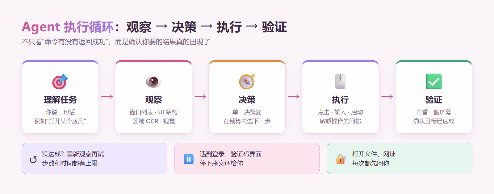
</p>

它和“让模型吐出一串命令然后照做”最大的不同是：**每一步做完都会再看一眼屏幕，确认你要的结果真的出现了**。启动命令返回成功，不代表正确的窗口已经打开；只有验证通过，任务才算完成。

<details>
<summary><b>设计细节</b>（点击展开）</summary>

- **一个循环、一个决策者** — 聊天和办事走同一个循环，由模型在步数和时间预算内选择下一步，避免多个规划器互相打架。
- **一个任务一张卡片** — 每一步做了什么都写在卡片上，随时可以点“终止”。
- **开口征求同意** — 会改动东西的步骤，角色先用自己的声音问你；你说“好”或“不要”就行，也可以点卡片上的按钮。
- **分层观察** — 先用开销小的方式看（窗口列表、UI Automation 结构），不够再用区域 OCR，最后才用视觉模型；界面元素会被编号标注，方便模型精确指认。
- **任务级授权** — 点击、输入这类操作在你授权任务后可连续执行；打开文件、打开网址、涉及文件路径的步骤和本地项目操作，每次都需要你重新确认。
- **执行后验证** — 操作完成后重新观察，确认目标状态；没达成会进入恢复流程，重新定位或换一种方式。
- **知道何时停下** — 遇到登录、验证码这类不该自动处理的界面，会停下来把控制权交还给你。
- **管理员权限窗口也能操作** — 遇到以管理员身份运行的软件（如游戏平台），会通过一个只在本机、一次性授权的辅助进程完成点击和输入，桌宠本身不需要以管理员身份运行。
- **安全边界** — 模型拿到的工具输出被当作数据而不是指令；Agent 文件工具不会接触凭据和应用数据；只信任应用自带页面发来的 IPC。

对话循环、确认规则和桌面操作的完整说明见[项目介绍](./docs/project-overview.zh-CN.md#对话循环聊天和办事是同一件事)。

</details>

---

<a id="quick-start"></a>

## 🚀 快速开始

### 方式一：下载便携版（推荐）

1. 打开 [Releases 页面](https://github.com/JingXuan-Zun/AI-Pets-Hub-public/releases/latest)，下载 `AI-Desktop-Pet-<版本号>.exe`。
2. 双击运行即可，无需安装。
3. 按下面的 [首次配置](#first-setup) 填好模型服务。
4. 以后有新版本，在 设置 → 总览 → 当前版本 里直接更新（从 v0.4.0 起）。

> [!NOTE]
> 应用暂未进行 Windows 代码签名，SmartScreen 可能弹出提示。请确认文件来自本仓库的 Releases 页面后再运行，也可以用发布页提供的 SHA-256 校验文件。

### 方式二：从源码运行

**前置条件：** Windows 10 / 11 64 位、[Node.js](https://nodejs.org/) 20 LTS 或更新版本、npm、Git。

```powershell
git clone https://github.com/JingXuan-Zun/AI-Pets-Hub-public.git
cd AI-Pets-Hub-public
npm ci
npm run desktop
```

`npm run desktop` 会先构建界面，再启动 Electron 桌面应用。只调试界面时可以用 `npm run dev`。

<details>
<summary><b>常用开发命令</b>（点击展开）</summary>

```powershell
npm run lint            # TypeScript 类型检查
npm run build           # 构建界面
npm run smoke:agent:p0  # Agent 核心冒烟检查
npm run dist:win        # 构建 Windows 分发版本
```

项目还提供按 Agent、Neural Persona、MCP、Skill 和桌面运行时划分的检查脚本，名称和参数以 [`package.json`](./package.json) 为准。

</details>

---

<a id="first-setup"></a>

## 🔑 首次配置

启动后打开 **设置中心**，按需完成以下配置：

1. **🤖 模型服务**（必需）：选择 Gemini 或任意 OpenAI 兼容接口，填写 API Key、接口地址和模型名称。这是角色聊天和 Agent 的基础。
2. **🎭 角色**：给角色起名字、写人格和系统提示词，导入 2D / Live2D / 3D 模型和动作资源。
3. **🔊 语音**（可选）：选择浏览器语音、OpenAI / Gemini 语音接口，或本地 GPT-SoVITS；在语音包页面为每个桌宠选一个声音，并设置唤醒词。
4. **👀 生活陪伴 / 🛠️ Agent**（可选）：按需开启；屏幕观察和桌面操作都会先征求你的同意。

> [!TIP]
> API Key 会用系统加密保存在本机，不会写进仓库或安装包；加密不可用时会拒绝保存，不会退回明文。

---

<a id="features"></a>

## ✨ 功能

### 🐾 桌面陪伴

<p align="center">
  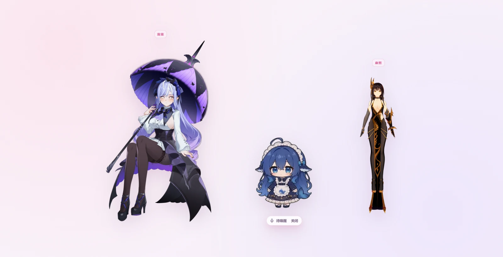
</p>

- **多种角色形态** — 支持 2D 图片 / 视频、Live2D（PixiJS + Cubism）、VRM / GLTF / GLB / FBX 等 3D 模型、**MMD（PMX / PMD）模型和 VMD 动作**，以及 Unity 运行时桥接。
- **真实的物理** — MMD 模型的头发、裙摆按模型自带的刚体和关节摆动；拖着角色走时会跟着甩起来，松手后自己荡回来。
- **动作与表情** — 待机、拖拽、点击互动和情绪表情由运行时统一调度；2D 视频桌宠可按文件夹轮播，并根据情绪播放对应片段。
- **多桌宠同屏** — 可以同时摆放多个角色，各自独立配置；在设置里拖动就能调整顺序。
- **独立窗口** — 桌宠、聊天、设置中心互相独立，又共享同一份状态。

### 🎨 粉色玻璃主题

<p align="center">
  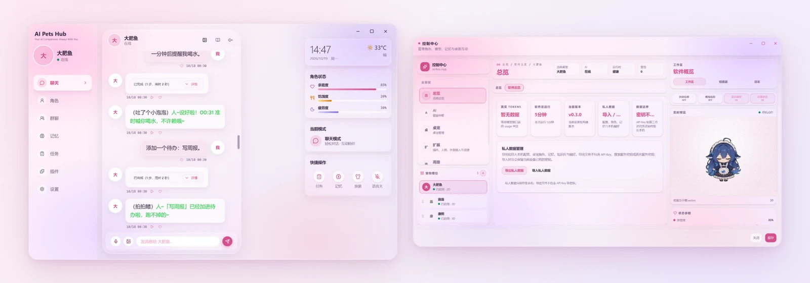
</p>

粉色玻璃风格界面，覆盖聊天窗口和设置中心；设置中心有实时预览，3D 模型会自动取景、完整显示。

### 💬 角色聊天

- **三种模式** — 单聊专注一对一陪伴；群聊让多个角色一起说话、互相接话；剧情模式适合演绎一段故事。
- **点名派活** — 和一个角色聊着，说“让 XX 去帮我……”，另一个角色接手，用她自己的名字和声音回答。
- **每个角色都会主动开口** — 开机问候、饿了、亲密度提升时，每个角色都会用自己的口吻说话。
- **人格与知识** — 每个角色有独立的名字、人格、系统提示词、知识库和对话上下文；SillyTavern 预设可以导入，并逐条开关。
- **长对话不失忆** — 聊天记录保存在本机，超长对话会自动生成过往摘要。
- **长对话也省钱** — 请求的写法会尽量用上模型服务的缓存（DeepSeek 实测：每条消息约 95% 按缓存价计费），聊得越久越划算。
- **自由选模型** — Gemini 和任意 OpenAI 兼容接口都可以用，支持流式回复和图片输入。

<p align="center">
  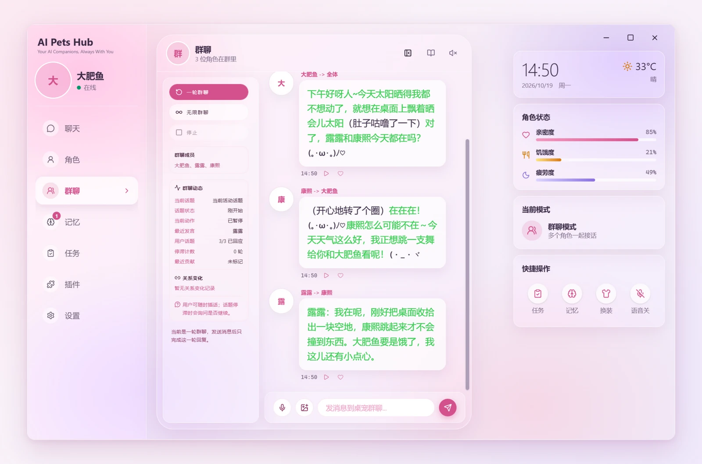
</p>

### 🧠 记忆与人格

<p align="center">
  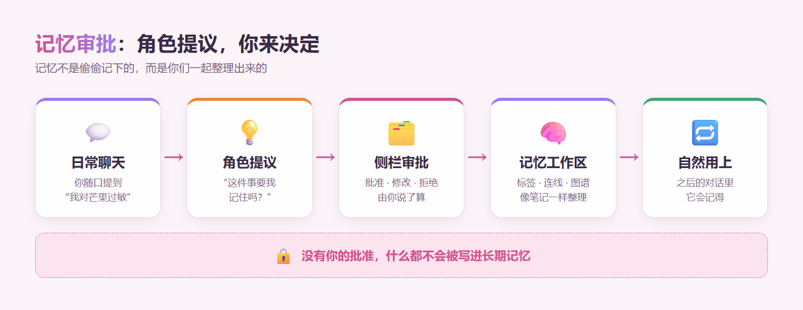
</p>

- **记忆审批** — 聊天中出现值得记住的事，角色会提出“要我记住吗？”；你在侧栏批准、修改或拒绝，**没有你的批准什么都不会写入长期记忆**。
- **“关于你”共享记忆** — 你对一个角色说“帮我记住”，所有角色都会知道；说“忘掉”会先确认再删除。
- **记忆工作区** — Obsidian 风格的记忆笔记：拖拽连线、打标签、看关系图谱，像整理笔记一样整理你们的回忆。
- **神经人格（Neural Persona）** — 把角色的长期信息组织成可浏览、可维护的人格图谱。
- **群体与关系** — 群体记忆、角色之间的有向关系和社交时间线，为多角色共处打基础。

<p align="center">
  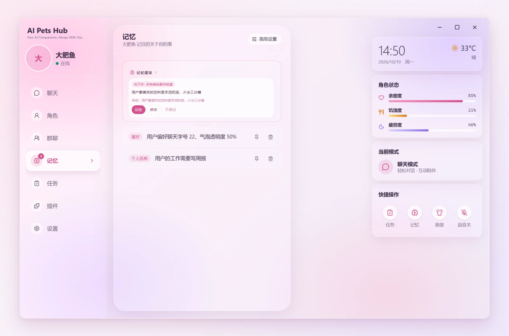
</p>

### 🔊 语音交互

- **角色专属声音** — 接入 GPT-SoVITS：轻量语音包只需几段参考录音，训练版语音包更接近原声；每个桌宠槽位可以绑定不同的声音。
- **多种语音来源** — 浏览器语音、OpenAI / Gemini 语音接口、本地语音运行时、GPT-SoVITS 任你选择。
- **免手动对话** — 开启后直接对角色说话；每个角色有自己的唤醒词，按发音匹配，听成同音字也能唤醒。
- **状态看得见** — 角色下方显示麦克风状态，“待唤醒”“正在听你说”一目了然。
- **长回复不卡顿** — 长回复按完整句子分组合成，边合成边播放。

语音包格式见 [`docs/voice-pack-format.md`](./docs/voice-pack-format.md)。

<p align="center">
  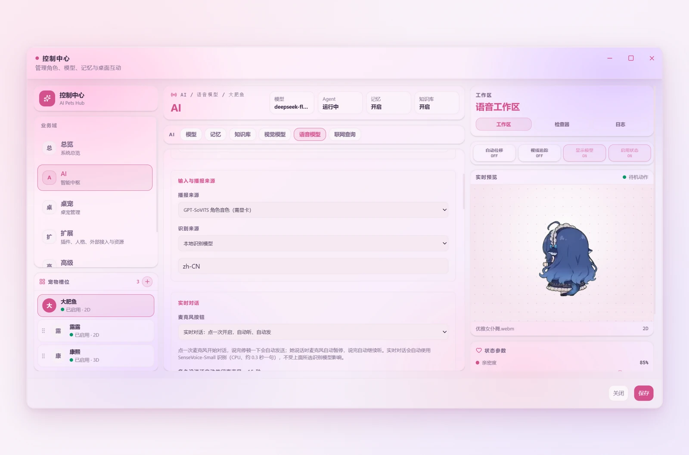
</p>

### 👀 生活陪伴

- **先问再看** — 角色想了解你在做什么时会先征求同意；同意后才开始观察屏幕。
- **随时断开** — 桌宠下方有“断开”按钮，在聊天里说不要也会立即断开。
- **主动关心** — 结合心情、好感、时间和安静时段，在合适的时候主动搭话。
- **陪玩** — 打游戏时隔一会儿看一眼画面，在合适的时候说两句；看的频率可以调（设置 → 高级 → 陪玩），随时可以停。

<p align="center">
  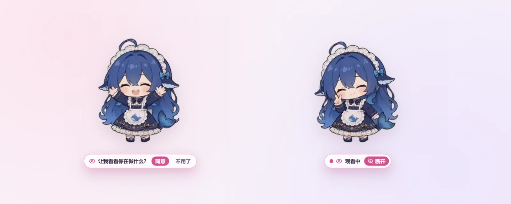
</p>

### 📞 互动对话（预览）

- **面对面聊天** — 右键桌宠选“互动对话”，角色出现在聊天窗口里，像视频通话一样对着你说话；通话时桌面上的这个角色先隐藏，挂断就回来。
- **每个角色单独调** — 设置 → 高级 → 互动对话：角色多大、放在哪、对话面板多宽多高，边调边看预览。
- **还在做的** — 口型和表情跟着她说的话动；她也能自己说“我们视频吧”打开通话。

### 🛠️ 说一句，她就去做

<p align="center">
  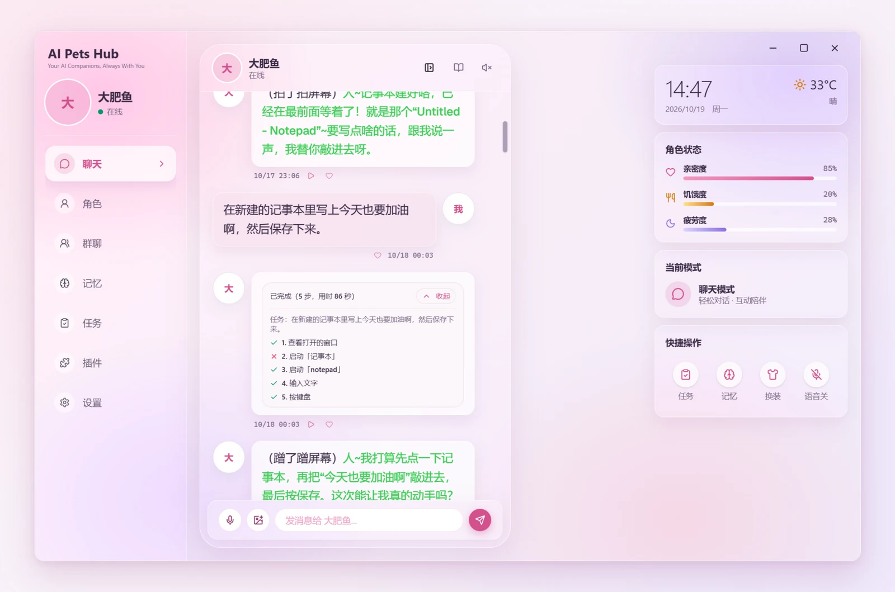
</p>

- **能动手的角色** — 打开软件、点按钮、输入文字、按键、打开网页、联网搜索、读写文件、查电脑配置、运行命令；需要管理员权限的软件也能操作（会先弹出系统确认）。
- **整理桌面** — 可以只整理某一块屏幕，按文件类型排好；也能把图标挪到指定屏幕的指定位置（如“副屏右下角”）。
- **挪窗口** — “把记事本放到副屏右下角”一步完成，窗口大小不变。
- **看得见的过程** — 每个任务一张卡片，一步步写着她在做什么；失败的步骤会标出来，她会换个办法再试。
- **卡住会停下来问你** — 遇到要登录或激活的软件、或者连着几步都不成功，她会停下来说清楚卡在哪，问你自己处理还是换个办法；做到一半被你插话打断，卡片会写“还没做完”，回头她会问要不要接着做。
- **实测** — 20 个常用任务（聊天、提醒、改设置、计算器和记事本、挪窗口、整理副屏、她的浏览器、上网查资料、读写文件、插件）全部完成，也能一句话连着跨 3～4 个软件做完；做的时候你在自己的浏览器里操作也互不影响。
- **可控的权限** — 只读观察和会改动东西的操作分开处理；改动之前先开口问你（也可以“今天都允许”），发送、删除、付款这类每次都问；随时可以点“终止”。
- **边做边聊** — 画图这类慢活放到后台，她一边做一边照常和你聊天，做完主动告诉你；中途说“别画了”就停。
- **守得住底线** — 她用命令也碰不到软件自己的设置文件、密钥和浏览器登录数据；装插件失败时她只会告诉你原因，不会自己去改配置。

工作原理见上方的 [Agent 执行循环](#agent-loop)。

### 📋 提醒 · 待办 · 番茄钟

- **说一句就记下** — “下午三点提醒我开会”“加个待办：写周报”“开个番茄钟”；时间到了她会亲口提醒你。
- **任务页** — 聊天中心的“任务”页把提醒、待办和番茄钟放在一起，和对话里说的是同一份数据。

### 🗣️ 说话就能改设置

- **常用设置一句话搞定** — “字大一点”“气泡透明点”“你变大一点”“别乱跑”“读慢一点”“括号里的动作别读”“把活动范围框隐藏”，说完立即生效。
- **管理角色和数据** — 在聊天里新建桌宠、给角色换模型、备份和恢复数据（会先确认，恢复前自动备份当前状态）。

### 🔌 扩展与集成

- **插件市场** — 设置 → 扩展 → 插件市场：在线插件经过审核才公开，安装前告诉你要哪些权限；每个插件可以按角色单独开关，有自己的说明页和设置。
- **发链接就能装** — 把 GitHub 上的插件链接发给她，她先读懂是什么（技能、MCP 工具还是插件包）、要电脑上有什么、来自哪里，告诉你“没经过审核”，**你同意了才装**（每次都问）。
- **和她一起做插件** — 市场里没有合适的，说清楚想要什么，她来写技能或小工具，装好就能用。
- **MCP** — 把 README 里的配置贴进“添加 MCP 工具”就能用；装好后自动写一句大白话说明它能做什么，她也知道装了哪些、各能干嘛；工具返回的截图直接发到聊天里。
- **她自己的浏览器** — 应用自带一个独立的浏览器（单独的数据，和你平时的浏览器、账号都不互通）；配合 chrome-devtools 插件，她能在里面打开网页、点按钮、填表、截图；她切换页面时不会抢走你正在用的窗口。在插件页点“打开她的浏览器”，把她的账号登录好就行。
- **QQ 连接** — 用 SnowLuma 连上 QQ，在手机 QQ 上和她聊天、发图片和语音，她用自己的声音回语音。
- **微信连接** — 用手机微信扫码连上（官方 ClawBot 通道，不用装电脑版微信），可以给家人各连一个；她的语音以短视频发过去。
- **ComfyUI 画图** — 连上你自己的 ComfyUI（也可以是局域网里的另一台电脑），说“画一张……”她把对话写成提示词，在后台画，画好的图出现在聊天里、也发到 QQ / 微信；装上同步扩展后，ComfyUI 里改的设置自动同步过来。
- **接口配置** — 存好几套模型接口（OpenAI 兼容 / Gemini），一个出问题时一键切换，也可以跟她说“换到备用模型”。
- **开发助手** — 把改代码、修 bug、给项目加功能的活交给 Claude Code（或兼容的编程模型），做完把结果告诉你；能改哪些项目文件夹由你指定。
- **Skills** — 导入技能说明，角色在对话里按需取用。
- **人格分享** — 导入或分享可复用的人格预设。
- **更多小能力** — 查天气、看看本机某个项目文件夹是什么、怎么启动，并帮你启动。
- **更多运行时** — Unity Bridge、DeepSeek Harness Bridge。

### 🔄 软件更新

- **在软件里更新** — 设置 → 总览 → 点“当前版本”，看到所有版本和说明，选一个就能换；默认有新版本时在后台下好，重启前问你。
- **只下载改了的部分** — 通常几 MB，不用每次重新下载整个程序；换了底层（Electron 或依赖）的版本会提示你下载完整安装包。
- **能换回旧版本** — 觉得新版本不好用，在列表里换回之前的版本或安装包自带的版本。
- **坏了自己退回** — 版本列表有签名、每个文件都核对；新版本启动不起来会自动回到上一个能用的版本，并告诉你。
- 从 **v0.4.0** 开始支持：用 v0.3.x 的朋友需要先下载一次完整的 v0.4.0。
- **导出诊断信息** — 遇到问题时在同一个地方点“导出诊断信息”，存一个文本文件发给帮你排查的人：版本、设置摘要和最近的运行日志；不含聊天内容和密钥。

---

<a id="faq"></a>

## ❓ 常见问题

<details>
<summary><b>要花钱吗？</b></summary>

软件本身免费（非商业用途）。聊天和办事要用你自己的模型服务，费用按服务商的价格和你结算。DeepSeek 这类 OpenAI 兼容接口比较便宜；长对话会尽量用上服务商的缓存，越聊越划算。
</details>

<details>
<summary><b>需要显卡吗？</b></summary>

聊天、办事、记忆都不需要。本地 GPT-SoVITS 角色语音建议有 NVIDIA 显卡；没有显卡可以先用浏览器语音或在线语音接口。
</details>

<details>
<summary><b>角色模型从哪来？</b></summary>

需要你自己准备：2D 图片 / 视频、Live2D、VRM、MMD（PMX + VMD）都可以，请确认你有使用授权。截图里的是演示角色。
</details>

<details>
<summary><b>我的数据存在哪？</b></summary>

聊天记录、记忆、角色设定和配置都在你自己的电脑上；API Key 用系统加密保存，不会写进仓库或安装包。
</details>

<details>
<summary><b>怎么更新？新版本不好用能退回吗？</b></summary>

设置 → 总览 → 点“当前版本”：能看到所有版本和说明，选一个就换，也能换回旧版本（从 v0.4.0 起支持）。
</details>

<details>
<summary><b>Windows 提示“已保护你的电脑”怎么办？</b></summary>

应用还没有做代码签名，所以 SmartScreen 会提示。确认文件是从本仓库的 Releases 页面下载的（可以对照发布页的 SHA-256），再点“更多信息 → 仍要运行”。
</details>

<details>
<summary><b>遇到问题怎么反馈？</b></summary>

设置 → 总览 → 当前版本 → **导出诊断信息**，把生成的文本文件发到 QQ 群或 [Issues](https://github.com/JingXuan-Zun/AI-Pets-Hub-public/issues)；文件里不含聊天内容和密钥。
</details>

---

## 🔐 隐私与安全

- **数据留在本机** — 聊天记录、记忆、角色设定和配置都保存在你的电脑上。
- **凭据加密** — 模型、搜索和语音的 API Key 用 Electron `safeStorage` 加密保存；已保存的模型密钥由主进程发起请求，不会回传到界面里。
- **改地址要重填** — 修改兼容接口地址后需要重新填写 API Key，不会把已保存的密钥转发给新地址。
- **你说了算** — 屏幕观察、打开文件和网址、本地项目操作都要先经过你的同意。

<details>
<summary><b>更多安全细节</b>（点击展开）</summary>

- 浏览器开发模式不会把 API Key 写入 `localStorage`，重新打开需要重新填写。
- 桌面旧存储副本在安全保存或迁移成功后会清除凭据字段。
- 搜索、语音等部分凭据的请求路径还没有全部迁到主进程。
- 加密配置不是跨设备的密钥备份。
- 安全问题请通过 GitHub 私密漏洞报告联系我们，在修复前请不要公开可利用细节。

</details>

---

## 📊 项目状态

项目处于早期公开开发阶段，核心体验已经可以使用，部分能力仍在打磨。

| 模块 | 状态 | 说明 |
| --- | :---: | --- |
| 桌面陪伴与多窗口 | ✅ 可用 | 桌宠、聊天、设置中心独立运行并共享状态 |
| 角色聊天（单聊 / 群聊 / 剧情） | ✅ 可用 | 需要自行配置模型服务 |
| 说一句就去做（对话 Agent） | ✅ 可用 | 20 个常用任务实测全部完成，能跨几个软件连着做；遇到要登录 / 激活的软件会停下来问你 |
| 提醒 / 待办 / 番茄钟 | ✅ 可用 | 数据保存在本机 |
| 记忆审批与“关于你”记忆 | ✅ 可用 | 神经人格与对话的深度接合仍在推进 |
| 语音与唤醒词 | ✅ 可用 | GPT-SoVITS 需自行安装，建议使用显卡 |
| 生活陪伴 / 陪玩 | 🧪 预览 | 屏幕观察需要你的同意，可随时断开；游戏画面里很小的数字可能看错 |
| 互动对话（视频通话） | 🧪 预览 | 角色在聊天窗口里面对面聊；口型和表情还在做 |
| 2D / Live2D / VRM / MMD 角色 | ⚙️ 需素材 | 运行时已就绪，模型和动作需要自行准备 |
| 插件市场 / 发链接装插件 | ✅ 可用 | 技能、MCP 工具、插件包；GitHub 上的插件要你同意才装 |
| QQ / 微信连接 | ✅ 可用 | QQ 需要 SnowLuma；微信走官方 ClawBot 通道，语音以短视频发送 |
| 她自己的浏览器（chrome-devtools） | ✅ 可用 | 需要 Node.js 和 Chrome；她的账号由你登录 |
| ComfyUI 画图 | ✅ 可用 | 已用真实 ComfyUI（局域网另一台电脑）实测；工作流写法差别大，个别需要手动指定提示词框 |
| 软件内更新 | ✅ 可用 | 从 v0.4.0 起 |
| 其他 MCP 工具 | 🧪 预览 | 第三方兼容性因服务而异 |
| Unity Bridge / DeepSeek Harness | ⚙️ 需环境 | 需要对应的外部运行环境 |

<details>
<summary><b>已知问题与开发重点</b>（点击展开）</summary>

**已知问题**

- 打开软件时，如果浏览器里有标题包含该软件名的页面，可能会切到那个页面而不是启动软件。
- 语音说英文软件名时容易识别错，建议说中文名。
- 2D 视频角色暂时不能按名字播放指定动作片段。
- 聊天侧边栏切换角色后，聊天窗口要重新打开才会跟着切换。
- 应用窗口尚未启用沙箱和 CSP。

**开发重点**

- 互动对话的下一步：口型和表情跟着她说的话动，她也能自己提出“我们视频吧”。
- 插件进程宿主：任意语言写的插件在独立进程里运行，权限更清楚。
- 导入别的桌宠平台的角色（先从 VPet 的角色动画开始，只导入你自己装过的）。
- 让角色自己上网学习、慢慢长出自己的样子（学到的东西要你同意才记下）。
- 让神经人格、长期记忆和角色关系更深地参与日常对话。
- 角色之间互通近况，让多个角色“知道”彼此和你聊过什么。

</details>

---

## 🧱 技术栈

<p align="center">
  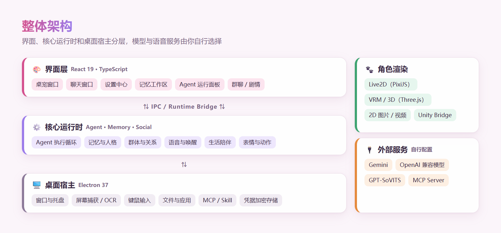
</p>

| 层 | 技术 |
| --- | --- |
| 桌面宿主 | Electron 37 · Electron Builder |
| 界面 | React 19 · TypeScript 5.8 · Vite 6 |
| 2D / Live2D | PixiJS 6 · `pixi-live2d-display` · Cubism Core |
| 3D | Three.js · React Three Fiber · `@pixiv/three-vrm` · MMD（PMX / VMD，ammo.js 物理） |
| AI | Gemini · OpenAI 兼容接口 · 自研 Agent 与 MCP Runtime |
| 语音 | GPT-SoVITS · 浏览器语音 · OpenAI / Gemini 语音接口 |

<details>
<summary><b>项目结构</b>（点击展开）</summary>

```text
electron/                 Electron 主进程服务与桌面集成
src/agent/conversation/   对话循环：聊天和办事共用，模型直接调用工具
src/agent/loop/           观察 → 决策 → 执行 → 验证 桌面 Agent 循环
src/platform-capabilities/ 角色能力清单（设置、角色、数据、天气、知识库等）
src/productivity/         提醒、待办、番茄钟
src/plugins/              插件系统：插件市场、发链接装插件、MCP、她的浏览器
src/qq-bridge/ · src/weixin-bridge/  手机 QQ / 微信连接
src/appUpdate/            软件内更新（主进程部分在 electron/appUpdate*.cjs）
src/pet-runtime/          2D / Live2D / 3D 角色运行时
src/neural-memory/        记忆提议、审批与记忆工作区
src/character-graph/      角色图谱与 Neural Persona
src/life-companion/       生活陪伴
src/voice/                语音合成、识别与唤醒
src/social-group/         群体交互
docs/                     项目介绍、语音包格式与维护说明
scripts/                  检查、构建和维护脚本
services/plugin-market/   插件市场和软件更新用的 Cloudflare Worker
```

目录只是入口索引，每一块怎么运作见[项目介绍](./docs/project-overview.zh-CN.md)。

</details>

---

## ⚠️ 免责声明

- 本项目不内置任何 AI 模型、语音模型或角色素材；你需要自行准备，并确认拥有相应授权。
- 使用第三方模型服务时，请遵守对应服务的条款；产生的费用由你与服务商结算。
- 桌面 Agent 会在你授权后操作你的电脑，请在信任的任务上使用，并留意每一步的确认提示。
- 本项目按“现状”提供，不对使用造成的任何损失承担责任。

---

## 📄 许可证

项目源码采用 [PolyForm Noncommercial License 1.0.0](./LICENSE)（源码公开、非商用许可）。

| 用途 | 是否允许 |
| --- | --- |
| 个人学习、研究、自用 | ✅ 免费 |
| 修改源码、做自己的版本 | ✅ 免费（非商业用途） |
| 非商业分享和再分发 | ✅ 免费，需附带许可证和版权声明 |
| 学校、公益组织、科研机构使用 | ✅ 免费 |
| 商业用途（售卖、付费服务、公司内部业务、广告变现、集成进商业产品等） | ❌ 需另行取得商业授权 |

**商业授权：** 请加 QQ 群 **1082932504** 联系我们。

上表是便于理解的摘要，具体以 [LICENSE](./LICENSE) 原文为准。

- v0.2.0 之前发布的版本（v0.1.0）按 Apache-2.0 发布，其授权不受本次变更影响。
- 应用图标中的角色插画由创作者保留权利，**不包含在源码许可范围内**；请阅读 [ASSET_LICENSES.md](./ASSET_LICENSES.md)。
- 第三方依赖、用户提供的角色模型 / 动画 / 音频及其他素材仍受各自许可约束；公开仓库的范围见 [PUBLIC_EXPORT.md](./PUBLIC_EXPORT.md)。

---

## 🤝 参与贡献

欢迎提交 Issue 和 Pull Request！较大的改动建议先开 Issue 讨论。反馈问题时请尽量附上：

- 诊断信息：设置 → 总览 → 当前版本 → **导出诊断信息**（版本、系统和最近的日志都在里面，聊天内容和密钥已自动去掉）
- 复现步骤、预期结果和实际结果
- 截图（**先遮住 API Key 和聊天内容**）
- 如果涉及 Agent，附上任务描述和运行面板里的步骤

贡献前请先阅读[隐私检查流程](./docs/PUBLIC_PRIVACY_WORKFLOW.md)。

---

<a id="contact"></a>

## 💌 交流与支持

- 💬 **QQ 交流群：1082932504**（使用交流、问题反馈、商业授权都可以在群里联系）
- 🐛 **问题反馈：** [GitHub Issues](https://github.com/JingXuan-Zun/AI-Pets-Hub-public/issues)

如果这个项目让你的桌面多了一点温度，欢迎点一个 ⭐ Star 支持我们！
